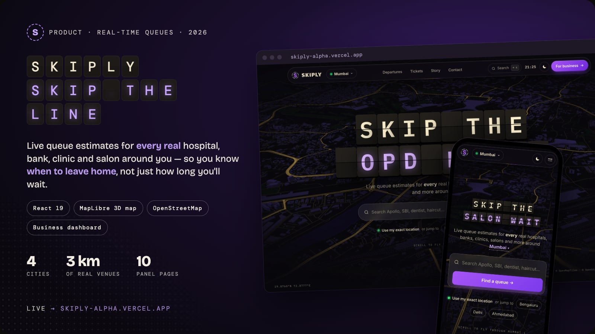

<a href="https://www.websk.dev">
  <picture>
    <source media="(prefers-color-scheme: dark)" srcset="assets/banner-dark.svg">
    <source media="(prefers-color-scheme: light)" srcset="assets/banner-light.svg">
    
  </picture>
</a>

  I design and build <b>websites with a pulse</b> — fast, sharp, and built to be remembered. 
  Every site loads fast, works on every phone, and has one idea people remember.

  <b>Freelance designer-developer</b> · B.Tech CSE, L.J. Institute, class of 2029 · <b>booking new projects for January</b>

  <a href="https://www.websk.dev"><b>Portfolio</b></a> &nbsp;·&nbsp;
  <a href="https://www.linkedin.com/in/shailesh-chaudhary-0a215a378"><b>LinkedIn</b></a> &nbsp;·&nbsp;
  <a href="https://www.instagram.com/shailesh29___"><b>Instagram</b></a> &nbsp;·&nbsp;
  <a href="mailto:websk2026@gmail.com"><b>Email</b></a> &nbsp;·&nbsp;
  <a href="https://cal.com/websk-cn7khp/30min"><b>Book a call</b></a>

 

### `01` &nbsp;Featured: Skiply

**Skip the line.** Live queue estimates for every real hospital, bank, clinic and salon around you — so you know when to leave home, not just how long you'll wait.

- **Every light is a real place.** A 3D city map built from OpenStreetMap: each column is a real venue, its height is the estimated wait. Drag to orbit, tap to open its queue.
- **A departure board for queues.** A split-flap board lists the venues near you with token, wait and status — tap a row to book.
- **When should you leave home?** Drag through the next twelve hours; Skiply picks the calmest moment and works backwards from your travel time.
- **Skiply for business.** Venues claim their counter and get a dashboard: live queue, departments, staff, analytics and reports.

React 19 · React Router · MapLibre GL · Leaflet · OpenStreetMap · Vercel

Started in 2025 as a team project with <a href="https://github.com/Anshum25">Anshum Dev</a> and <a href="https://github.com/Maurya-15">Maurya Doshi</a>. In November 2026 I rebuilt it into the version that is live today.

[**Live app**](https://skiply-alpha.vercel.app) &nbsp;·&nbsp; [**Repository**](https://github.com/shailesh2229/skiply)

 

### `02` &nbsp;Selected work

<table>
  <tr>
    <td width="50%" valign="top">
      <a href="https://www.websk.dev"><b>Websk Portfolio</b></a> live 
      My own site — a fluid halftone face you can smear, a site that remembers you between visits, festivals that dress it up on their own and a four-tap brief builder. 
      Next.js 16 · React 19 · three.js / WebGL · GSAP · Tailwind
    </td>
    <td width="50%" valign="top">
      <a href="https://shivkrupa-fabricon.vercel.app/"><b>Shivkrupa Enterprise</b></a> live · client 
      Website for a steel sheet cutting shop — its services and capabilities, laid out clearly for buyers. 
      Web design · Development
    </td>
  </tr>
  <tr>
    <td width="50%" valign="top">
      <a href="https://shailesh2229.github.io/karnavati-dairy/"><b>Karnavati Dairy</b></a> live · client 
      Ahmedabad's milk shop since 2005, rebuilt as a bilingual milk book — English and ગુજરાતી, order on WhatsApp, find the nearest of 39 shops. 
      Next.js 16 · TypeScript · Tailwind v4 · <a href="https://github.com/shailesh2229/karnavati-dairy">repo</a>
    </td>
    <td width="50%" valign="top">
      <a href="https://chronox20.vercel.app"><b>ChronoX</b></a> live 
      A luxury watch store — hero carousel, shop, cart and login, styled around timeless classic pieces. 
      HTML · CSS · Bootstrap 5 · <a href="https://github.com/shailesh2229/chronoX">repo</a>
    </td>
  </tr>
  <tr>
    <td width="50%" valign="top">
      <a href="https://friend-o.vercel.app"><b>FriendO</b></a> live 
      Find friends who share your interests — art, music, gaming, fitness and more — with sign-up and discovery pages. 
      HTML · CSS · Bootstrap 5 · <a href="https://github.com/shailesh2229/friendO">repo</a>
    </td>
    <td width="50%" valign="top">
      <a href="https://www.websk.dev/contact"><b>Your project?</b></a> 
      The next one on this list could be yours. Four taps on my site write the brief for you. 
      <a href="https://www.websk.dev/contact">Build your brief →</a>
    </td>
  </tr>
</table>

 

### `03` &nbsp;Stack

 
<b>Frontend</b> · Next.js · React · TypeScript · Tailwind CSS · three.js / WebGL · GSAP · Framer Motion

 
<b>Foundations</b> · HTML · CSS · Bootstrap · Node.js · Java

 
<b>Design &amp; ship</b> · Figma · Git · GitHub Pages · Vercel · VS Code

 

### `04` &nbsp;Activity

<picture>
  <source media="(prefers-color-scheme: dark)" srcset="assets/activity-dark.svg">
  <source media="(prefers-color-scheme: light)" srcset="assets/activity-light.svg">
  
</picture>

<i>There's always one more idea.</i>

<a href="https://www.websk.dev">websk.dev</a> · Ahmedabad, India

